# Gaussian Splat Patch (Blender 5.3+)

Erase, clone stamp and heal 3D Gaussian splat scans inside Blender, using Blender 5.3's
native splat import (`File > Import > PLY / SPZ`). Built for cleaning insect specimens:
dust, stray hairs, and the pin and the hole it leaves.

Sidebar: **3D Viewport > N > Splat Patch**.

| Top of the thorax as scanned, with the pin | Pin erased, strays removed, hole bridged (a thin shadow remains), fibres and specks retouched |
|---|---|
| 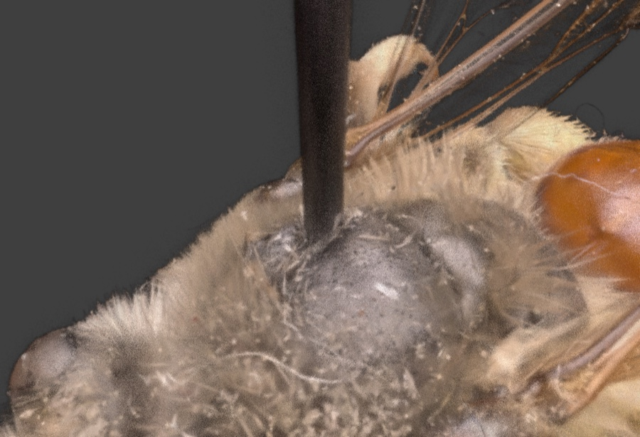 | 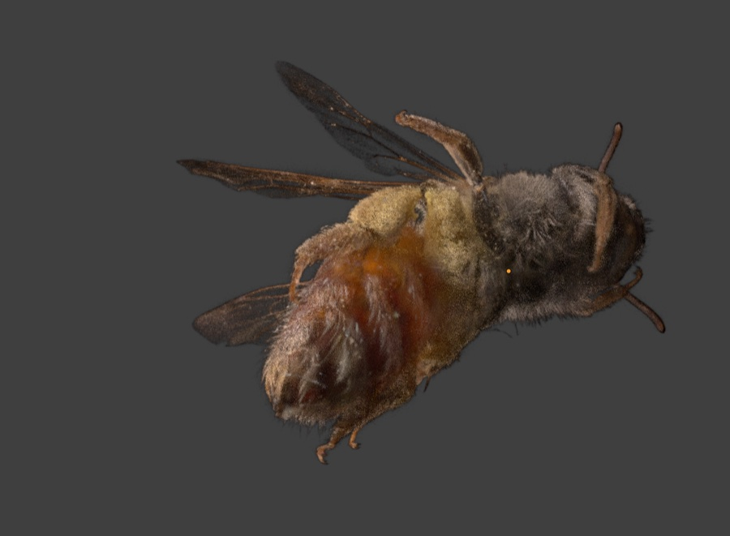 |

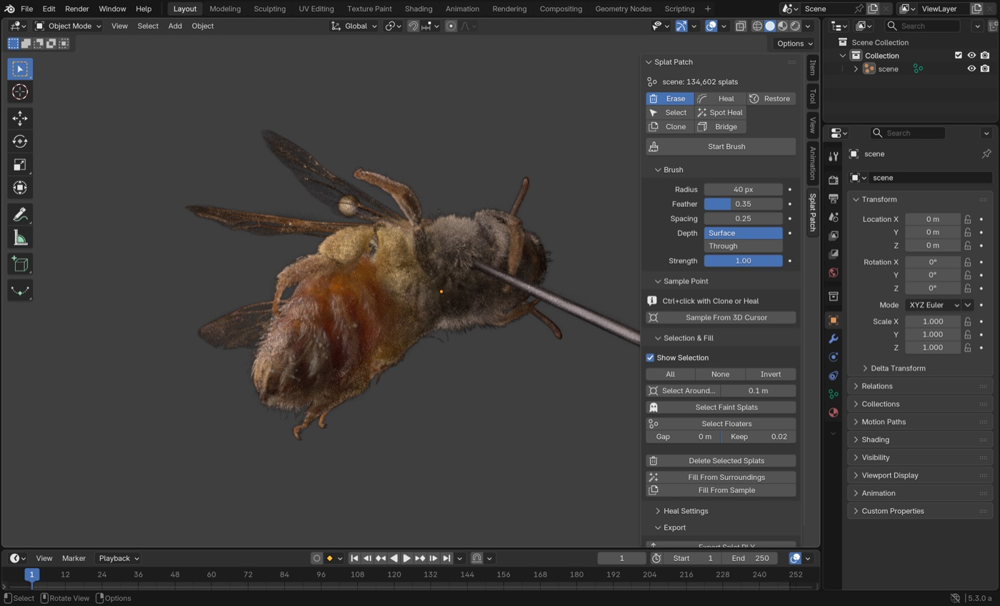

### Retouching dust and fibres

Close-ups from the same session and camera, before and after:

| Stray fibres lying on the hair: **Erase** along them with a small brush | |
|---|---|
| 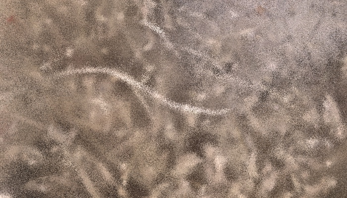 | 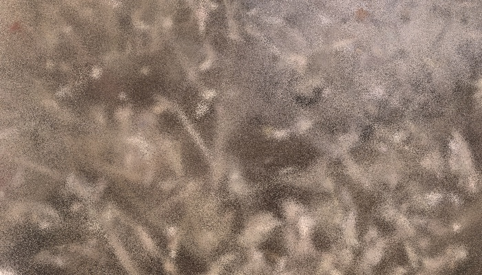 |

| White specks on the thorax plate: **Spot Heal** over each one | |
|---|---|
| 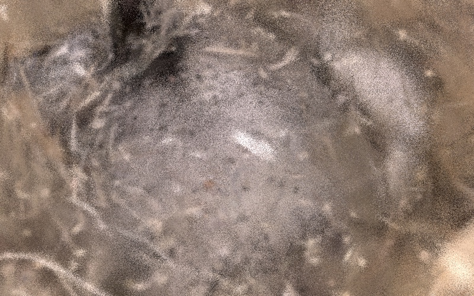 | 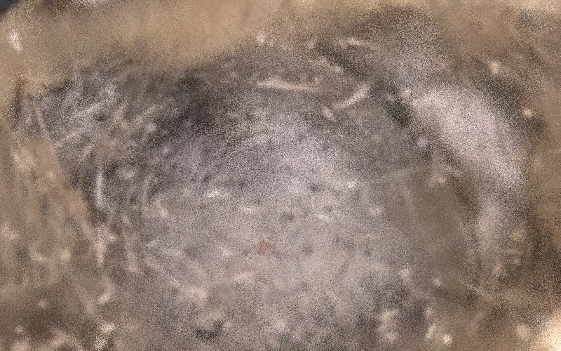 |

**Tip:** splats look much darker than they really are in Blender's default Solid lighting. In the
viewport's **Viewport Shading** dropdown, set **Lighting → Flat** to see the scan's true colours while editing.

## Install

Download `gs_patch-*.zip` from [Releases](https://github.com/timfennell/blender-splat-patch/releases),
then in Blender use **Edit > Preferences > Get Extensions > ⌄ > Install from Disk…** and pick the zip.
Requires Blender 5.3 or newer.

## Tools (brush)

Pick a tool button to start painting. While the brush is running:

| Key | Action |
|---|---|
| **Painting** | |
| LMB drag | paint with the current tool |
| Hold **Option / Alt** (or Ctrl) | Select: deselect instead of select. Checked on every dab, so press or release it mid-stroke |
| **Ctrl**+LMB (or Option/Alt+LMB) | Clone / Heal: set the sample point |
| **Tools** | |
| **E** or `1` | Erase |
| **S** or `2` | Select |
| **C** or `3` | Clone |
| **H** or `4` | Heal |
| **J** or `5` | Spot Heal |
| **B** or `6` | Bridge |
| **R** or `7` | Restore |
| **Brush** | |
| **F** | resize the brush: move the mouse, then click or F to set (Esc / right-click cancels) |
| **Shift F** | set the feather the same way |
| `[` `]` | smaller / larger brush |
| Shift `[` `]` | less / more feather |
| `X` | Surface ↔ Through depth (Through reaches every depth, e.g. a whole pin) |
| **Edit** | |
| **Delete** / Backspace | erase the selected splats |
| **Leaving** | |
| Esc / Enter | stop the brush (works with the mouse anywhere) |
| Ctrl+Z / ⌘Z | blocked while painting (use Restore); after you stop, it takes back the whole brush session |
| **View** | |
| MMB drag, scroll wheel, trackpad | orbit, zoom and pan as usual while painting |

Starting the brush switches Solid view to **Flat** lighting so the splats show their true colours. The
same list is in the panel under **Shortcuts**.

Strokes don't create Blender undo steps: use the **Restore** brush to undo edits anywhere. On scans over
a million splats the panel buttons don't either, because every undo step keeps another full copy of the
cloud in memory (about 1.2 GB per step at 5 million splats, up to 32 steps). On such scans Ctrl+Z after
some other action can jump back past your splat edits; Ctrl+Shift+Z brings them back.

- **Erase**: deletes splats; the feather fades them instead. Erase, Select and Spot Heal also work over
  empty space: with nothing solid under the brush (a white circle), they take everything under the
  circle at any depth. Needle-shaped splats count wherever their length crosses the brush, not just at
  their centre.
- **Select**: paints a region to use with the Selection & Fill buttons. Hold Option/Alt to deselect.
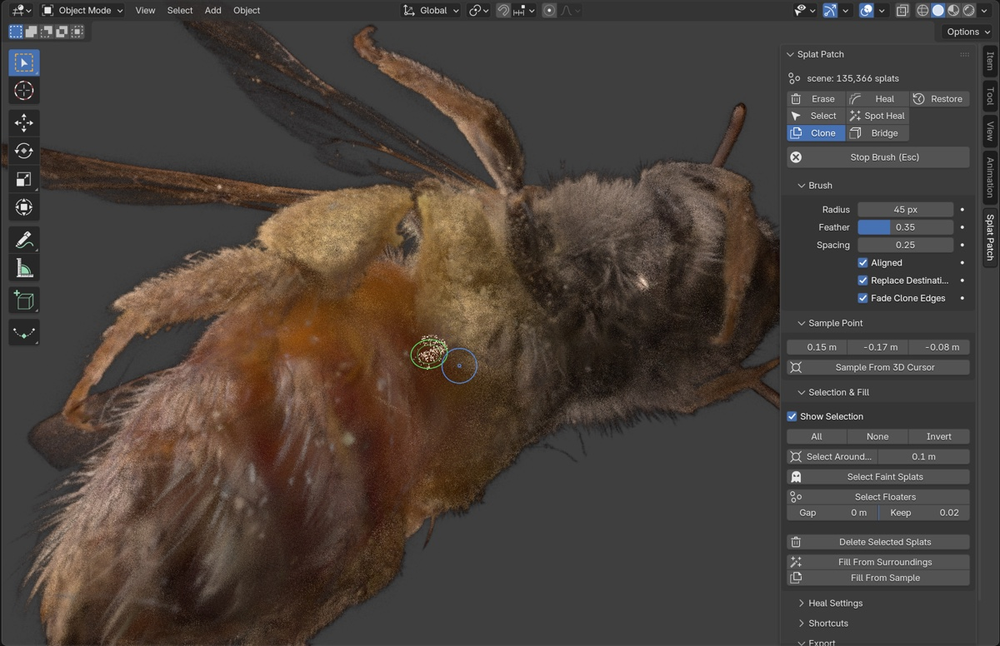

- **Clone**: works like Photoshop's clone stamp. Ctrl+click a clean area, then paint over the defect. The splats
  are rotated to fit the target surface's normal, including their view-dependent colour (SH bands 1–3),
  so highlights and sheen turn with the surface. *Aligned* keeps the offset between strokes.
  *Replace Destination* removes what was there, crossfading across the feather.
- **Heal**: clones like Clone, then shifts the colour to match the ring around the destination.
- **Spot Heal**: size the brush to cover the blemish (F) and paint over it. Like Photoshop's spot healing
  brush, it picks a matching patch nearby by itself (same surface direction, similar surroundings), clones it
  over the spot and matches the colour. It works on the front surface you're looking at, so Surface/Through
  doesn't matter. For a hole that's already empty, use Bridge instead.
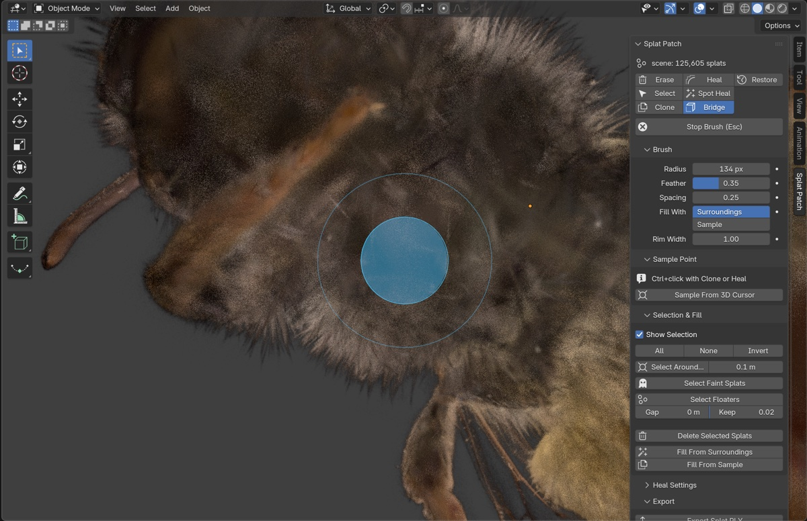

- **Bridge**: for a hole that is already empty (e.g. after erasing a pin). Look at the hole and paint over
  it, a little onto the intact surface around it. The tool reads the surface in a rim around what you
  painted, keeping only the layer at the hole's edge (not the inside of the hole, or a leg or wing crossing
  the rim). It fits a gently curved surface across the gap and covers it with splats, either grown from
  the rim (*Fill With: Surroundings*) or cloned from the sample point and colour-matched (*Sample*).
  Anything deeper in the hole is left alone and ends up behind the new surface. Clone and Heal then work on
  top of the bridge. *Rim Width* sets how wide a ring is read, as a multiple of the brush radius.

## Bridge workflow: filling the hole a pin leaves

Bridge is for a hole that is already **empty**, like the one left after erasing a pin. It reads the intact
surface in a ring around the area you paint, fits a smooth surface across the gap, and grows new splats on
it, continuing the fuzz or shell from the edge of the hole.

**1. The pin.** The specimen as scanned, with the pin going into the top of the thorax.

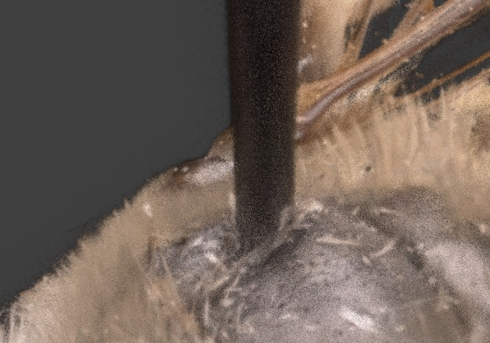

**2. Erase the pin.** With the **Erase** brush (Surface mode is fine), drag along the pin, starting next to
the body and moving outwards, so each stroke starts on the pin rather than behind it. Dab any stubs left
by the body, then press **Select Floaters** and **Delete** to clear the stray bits. That leaves a dark hole
where you can see into the body.

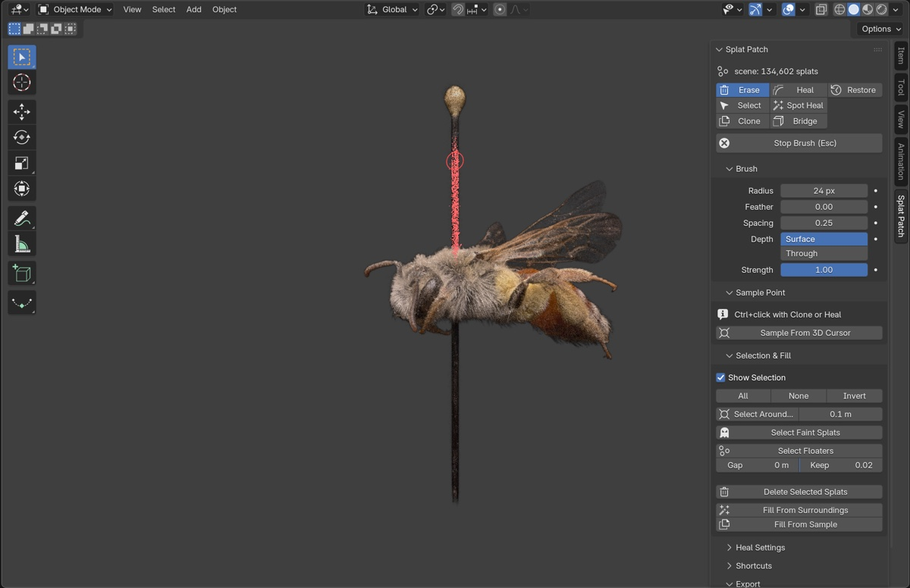

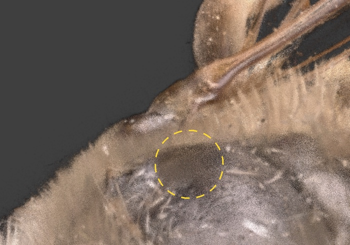

**3. Paint over the hole with Bridge.** Orbit until you're looking into the hole. Press **B** (or click
**Bridge**) and press **F** to size the brush. The solid ring is the brush; the fainter outer ring is how much
surrounding surface it reads (*Rim Width*). Drag over the whole dark area, a little onto the intact surface:
what you paint shows as a blue fill. Nothing changes until you let go.

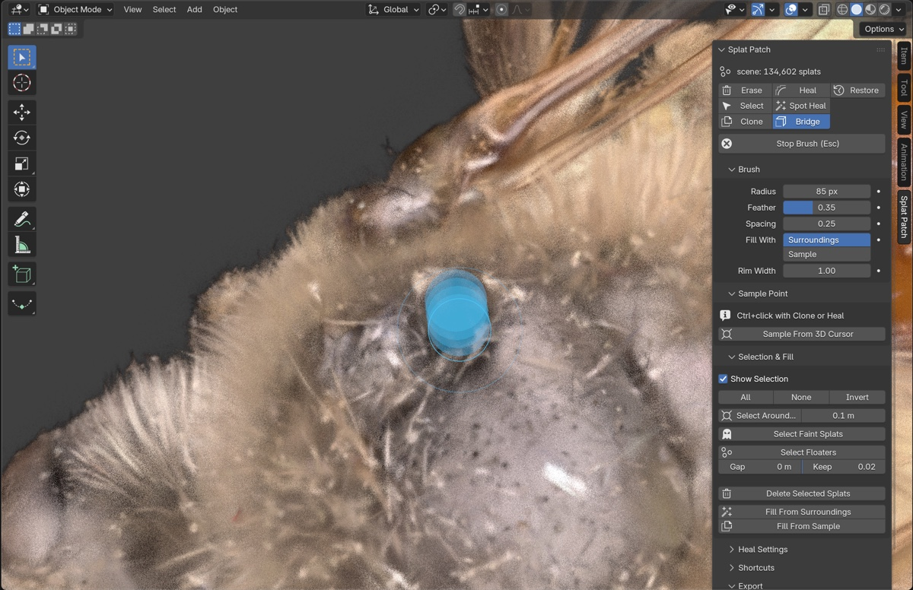

**4. Let go, then check from another angle.** Bridge fills the parts of the painted area that are deeper than
the surrounding surface, as seen from your view, with splats copied from the rim. Orbit and look again: in
this session a second Bridge stroke from the angle below filled more of it (the two strokes added about 700
splats). A faint shadow can remain in a deep, narrow hole; a few light **Clone** strokes from a nearby patch
cover it.

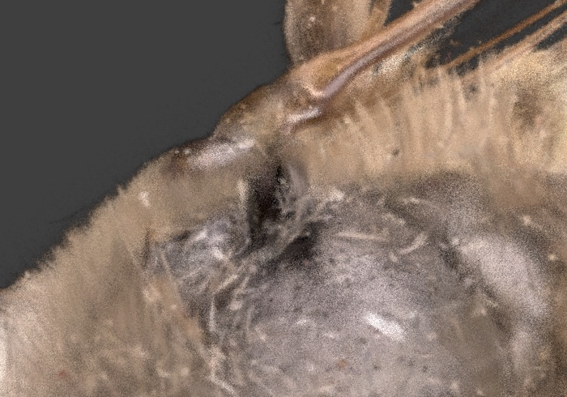

**Tips**
- *Fill With: Sample* clones the area around your sample point (Ctrl+click with Clone first) onto the
  bridge instead, colour-matched to the rim. Use it when the surroundings are too plain or too patchy.
- Where the area was very hairy, the bridge can look smoother than its surroundings. A few light Clone
  strokes from a nearby hairy patch on top blend it in.
- If the bridge looks wrong, press **R** (Restore) and paint over it: only the bridge's splats are removed,
  and you can try again from a straighter view.

All the screenshots in this README come from one editing session on the Big Bee scan, made only with the
add-on's own brushes, keys and panel buttons, as a user would.

## Restore (non-destructive edits)

Edits are recorded, so any part of the model can be taken back to the original scan:

- Splats that an edit removes (erase, clone's *Replace*, spot heal, fill, Delete Selected) aren't deleted:
  they're hidden in place (opacity 0) with their original opacity kept, and saved in the .blend.
- Splats that an edit adds are tagged, and splats that a feathered edit fades keep their original opacity.

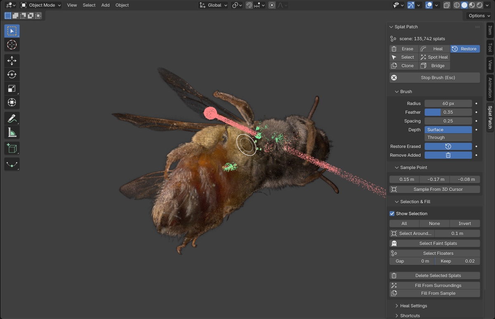

With the **Restore** brush (`7`) active, splats added by edits show **green**, erased ones **red**
(at the place they were), and faded ones **yellow**. Paint to take the area under the brush back to the
original. The two toggles choose what a stroke does:

- **Restore Erased** brings back red splats and resets yellow ones to their original opacity.
- **Remove Added** deletes green splats.

Restoring everything returns the original scan exactly, every splat and attribute. **Export Splat PLY
bakes the edits**: the file contains only the visible result, and the stash stays in the .blend so you
can keep refining. Edits made before version 0.1.3 were not recorded and can't be restored.

## Selection & Fill (the sample / edit / fill volumes)

1. Select the volume to remove: paint with **Select**, use **Select Around Cursor** (sphere at the 3D
   cursor), **Select Faint Splats** (near-transparent haze), or **Select Floaters**. Floaters are clumps
   not connected to the specimen, such as wisps left where a pin was. *Gap* sets how far apart splats can
   be and still count as connected (0 = automatic). *Keep* protects clumps at least that fraction of the
   largest one, such as a detached leg.
2. **Delete Selected**, or
3. **Fill From Surroundings** (spot-heal the selection), or **Fill From Sample**: clone the area around
   the sample point into the gap, trimmed to the gap's footprint, feathered and colour-matched.

The fill fits a smooth surface to the ring of splats around the gap, finds the gap in that surface, and
fills it to the ring's density. Heal Settings (Border, Grain, Colour Smoothing, Density) tune it.

## Level of detail: light stand-ins while arranging

Several multi-million-splat scans make the whole viewport slow. Select the models you're arranging and
press **Low Detail** (Level of Detail panel): each shows a stand-in with a share of its splats (10% by
default, the **Detail** slider). The most visible splats are the likeliest kept, and each kept splat
carries the opacity of the ones dropped around it, so wings and fur stay their density. Stand-ins have
no view-dependent colour, so they look slightly warmer. The full models stay in the .blend
but aren't drawn or evaluated; **Full Detail** brings them back.

While a stand-in shows, the brushes and selection tools are off (they need the model), and
**Export**, **Merge** and **Bake** use the full model. With the
[Spirula Render](https://github.com/timfennell/blender-splat-render) engine (0.10.3 or later), F12
renders use the full models and the viewport the stand-ins.

### Work area: full detail where you brush

To retouch part of a model while the rest stays light, put the 3D cursor on the spot, set
**Work Radius** and press **Focus Work Area**. Inside the sphere (drawn as an orange wire) every
splat of the full model is back, view-dependent colour included; outside it the stand-in stays.
The brushes and selection tools work as usual inside it. The low-detail surroundings are
locked: they're never erased, selected, cloned from or healed with.

Edits go into the full model when you move the area (Focus again with the cursor somewhere
else), when you press **Leave Work Area** (back to a stand-in, rebuilt from the edited model) or
**Full Detail**, and on their own before an F12 render, **Export**, **Merge** and **Bake**. So
renders are always full detail with every edit in them. Erased splats outside the area can be
restored once the area covers them again.

## Bake: make the edits permanent

Erasing hides splats rather than deleting them, and every edit keeps bookkeeping (what was erased,
added or faded, and the erased originals the Restore brush can bring back), so the model keeps its full
size while you work. When you're happy with it, **Bake Edits** (in the Bake, Merge & Export panel)
deletes the erased splats, drops the stashed originals and the bookkeeping, and leaves a plain model of
its visible splats: smaller in memory and in the .blend. It asks first, since Restore can't bring back
anything erased before the bake. What you export doesn't change (export already leaves erased splats
out); the brushes keep working on a baked model, with a fresh history.

## Merge: several models into one

To composite several scans (or several copies of one) into a single model: place them as you want
them, select them all, make the one whose position should anchor the result active, and press
**Merge Splat Objects** (in the Bake, Merge & Export panel). It makes one new object, `<active>_merged`, exactly
where the models were:

- every splat's position, rotation and size is carried into the active object's space, and its
  view-dependent colour (the higher SH bands) is turned with it, so it still looks right from every side;
- erased splats and the Restore brush's history come along (the merged model can still be restored);
- models with different SH degrees or attributes are padded to match;
- the originals are hidden (or kept visible, or deleted: a choice in the dialog).

Then **Export Splat PLY** writes the merged model as one file. Tested with a scaled, rotated and
moved copy: positions, orientations, sizes and view-dependent colour match the originals to float
precision, and the merged model renders identically. A non-uniform scale or a mirrored object can't be
carried exactly by splats: their average scale or nearest rotation is used, with a warning. Merging
holds a working copy of every model at once (about 250 bytes a splat).

## Mesh to Splats: polygon assets in a splat scene

Select one or more meshes and press **Convert to Splats** (in the **Mesh to Splats** panel). Each mesh
becomes a splat object, `<mesh>_splats`, with no training: an even UV layout is made for a copy of the
mesh, Cycles bakes its materials into it, and every covered texel becomes one flat splat lying in the
surface. Modifiers are included, and image, procedural, Generated and Object textures all come through. The mesh is
kept, hidden; edit it and press **Convert Again** with the splat object active to refresh it in place.
Then merge the result with your scans and export one PLY.

**Lighting**
- **Light on Camera** (default): the colour a scan would have learnt with the light fixed to the camera,
  the way the bee was captured. That is what Vintage Click's and Spirula Render's relighting read: band 0-1
  as diffuse from each lamp, bands 2-3 at the half vector as shine. Through the game's relight formula the
  diffuse comes within about 10 % of true Lambert shading, and the splats cast and receive the game's
  live shadows like any scan.
- **Light from Scan:** for putting assets into a scan of a real place, lit by its own light.
  Spirula Render renders the scan around the object (six views from its centre, with no lens, filter
  or film, and any uncovered background filled from the World), and Cycles lights the mesh with that
  as its World, so the asset takes the scan's brightness, colour and direction of light with no
  tuning: a white ball in a room of display grey 0.6 comes out at 0.54-0.59. The splats themselves
  are hidden from Cycles, and the scene's lamps only light the asset when Spirula is relighting the
  scan with them too. The scan's reflections go into the view-dependent colour (bands 1-3: a scan of
  a place is relit from its base colour alone, so they're free). **Contact Shadows** adds a separate
  layer, `<mesh>_shadow`, of black splats laid on the scan where the object blocks its light: the
  share of the surrounding light blocked at each point, on an even grid so they don't stack. The
  scan's own splats are never changed. Merge the shadow layer along with the asset.
- **Bake Scene Lighting:** Cycles bakes the scene's lights and shadows into a flat colour. It looks right as it is;
  relit, the baked shadows stay put.

**Settings**
- **Splat Spacing:** distance between splats (0: 1/400 of the object's size). Halving it makes four
  times as many splats.
- **SH Degree:** *Match Scene* uses the highest degree among your scans, since one PLY has one degree.
- **Brightness:** exposure of the converted colour; match it to your scans.
- **Shine:** bands 2-3 can't draw a highlight narrower than about 30 degrees. Shine keeps a narrow
  highlight's brightness (up to display white) drawn that wide; 0 gives its true, faint spread energy.
  Bands 2-3 always dip below zero somewhere, so the shine is limited where that dip would darken the
  surface by more than a third (no black rims on shiny objects).
- **Reflect Surroundings:** six small renders from the object's centre, with the scene's own engine
  (a Spirula Render scene shows its splats), blurred for each roughness and baked into bands 2-3.
  It's a frozen reflection map, not raytracing, and game lamps read it as highlights.
- **Two-Sided:** splats on both faces, for open surfaces like leaves and cards.

In Spirula Render, set **Shadow Density** to 1 for converted meshes: they're solid, and the default of 4
(for scans with leaky walls) makes their splats shadow each other in a fine grid.

## Export

Blender 5.3's PLY exporter writes 0 points for a point cloud, so use **Export > Export Splat PLY**.
It writes the standard INRIA 3DGS layout that Brush, SuperSplat and Blender read. A round trip matches
the original file exactly. Positions are written in object space (the object transform is ignored; merge
models first to bake their placement in).

## Limits

- **Built against the Blender 5.3 alpha.** The tool relies on how 5.3 stores splats (attributes such as
  `radiance:base`). If that changes before the final release, the tool will need an update.
- **Large scans:** on a 2-million-splat scan, starting the brush takes about 1¼ s, hovering and dabs a few
  milliseconds, and erase/select/restore strokes under 0.1 s. Strokes that add splats (Clone, Heal,
  Spot Heal, Bridge) take about 0.6 s, because Blender has to rewrite the whole cloud when it grows.
  While the brush runs it holds a working copy of the scan (about 3 GB at 5 million splats); it's freed
  when you leave the brush. Export streams to the file and needs little extra memory.
- **Erased splats stay in the .blend.** They're hidden, not deleted, so they can be restored; the file
  keeps its full size while you edit. Export Splat PLY leaves them out of the exported file.
- **Bridge rebuilds one surface layer.** Where the gap was thick with hair, the bridged patch can look
  smoother than its surroundings; a pass of Clone or Heal from a hairy area on top blends it in.
- **Restore only knows edits made with version 0.1.3 or later.** Earlier edits are permanent.
- **Tested on three bee scans:** standard 3DGS PLY files (one exported from Brush), up to 135k splats,
  plus a 2-million-splat test file. Other trainers' standard PLYs should load the same way.

## Development

```
blender --command extension build --source-dir gs_patch --output-dir dist
blender --command extension install-file -r user_default -e dist/gs_patch-<version>.zip
```

Tests (any 3DGS PLY):

```
blender -b --factory-startup --python tests/test_core.py -- scan.ply
blender --enable-event-simulate --python tests/test_ui.py -- scan.ply
blender -b --factory-startup --python tests/test_convert.py
blender -b --factory-startup --python tests/test_scan_light.py    # needs Spirula Render
```
